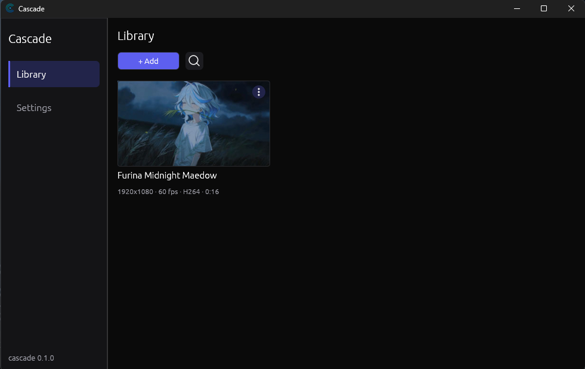
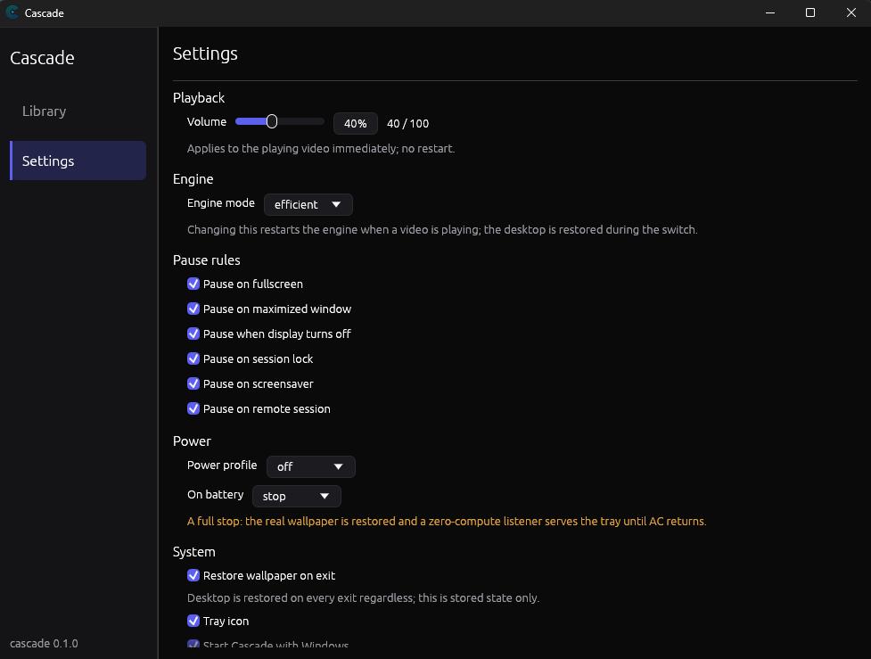

<div align="center">
  

  <h1>Cascade</h1>
  <p><strong>A Lightweight Live Wallpaper Engine for Windows 11, written entirely in Rust.</strong></p>
</div>


Cascade is built for one job: video live wallpapers. It decodes with Windows Media
Foundation and draws with Direct3D 11, with no bundled player, WebView2, or Electron
behind it. That focus keeps the binary and the background work small.

Cascade also follows rules on its own. It pauses when the desktop is not visible, and
with `on_battery = stop` it fully stops playback, restores the real wallpaper, and keeps
a near-idle listener for the tray and CLI. When AC power returns, playback starts again
automatically — no engine, host window, or polling timer runs while it waits.

## GUI

The GUI is the main way to use Cascade. After installing, open it from the Desktop or
Start Menu shortcut. It has three pages.

### Library

[](img/library.png)

Add the video files you already have, search them by title or path, and choose the one
to play. Removing a video from the Library only removes the entry — Cascade never
copies, moves, renames, or deletes your files. Missing files are pruned from the list,
not from disk.

### Settings

[](img/settings.png)

Adjust the video's own volume, pause rules, autostart, and engine mode. Volume is
0–100 and starts muted at 0; it does not change the system master volume. The default
`accurate` mode keeps the video's colour flags but costs noticeably more CPU and
memory. `efficient` is cheaper but has a known colour defect on BT.601 videos.

### Monitors

Choose which monitor gets the next video, or move the current video to another monitor.
Cascade plays one video on one target monitor.

Everything in the GUI is also available from the command line. See
[Commands](#commands) below.

## What you need

- Windows 11.
- A video Cascade can play: H.264, 8-bit 4:2:0 (MP4/MKV/MOV). 1080p60 is the tested
  baseline, not a limit: 1440p and 4K files are accepted when the hardware decoder
  supports them, at higher GPU and memory cost. Other formats are refused with a clear
  message; Cascade does not convert them.
- A graphics card that supports D3D11. Windows picks the adapter; Cascade does not
  install codecs, backends, or any other software.

## Install and run

Download `cascade.exe` and double-click it. Cascade asks once before installing to
`%LOCALAPPDATA%\Cascade`, adds a Desktop shortcut, a Start Menu shortcut, a command-line
shim on your user PATH, and per-user autostart. No admin rights are needed.

Installing also starts the wallpaper. You can install from PowerShell instead:

```powershell
.\cascade.exe install
```

`uninstall` reverses those steps. If you just want to try Cascade without installing:

```powershell
.\cascade.exe run --detached --video "C:\Videos\clip.mp4"
```

`--detached` returns at once and the wallpaper keeps playing when you close the terminal.
Plain `run` stays in the foreground for debugging; closing that terminal stops playback
and restores the desktop.

## The safety promise

- **Your wallpaper setting is never changed** by Cascade.
- The desktop is restored on every exit path: tray, Ctrl+C, closing the terminal,
  logoff, and crashes.
- A blank desktop left by a hard kill is repaired on the next start.
- Playback pauses when the desktop is not visible (fullscreen, lock, display off).
- Cascade never prevents sleep, shutdown, or logoff.

## Known limitations

- **The verified baseline is H.264 8-bit 4:2:0 at 1080p60.** Cascade has no resolution or
  frame-rate cap in code; 1440p and 4K are not rejected for being large. They are not
  verified here and cost more decode work, GPU memory and battery. HEVC, VP9, AV1,
  10-bit and HDR are refused with a clear message; convert such files yourself before
  adding them.
- **No built-in transcoding or optional backends.** Cascade plays the file as-is and
  makes no network calls.
- **Hardware coverage is generic, not exhaustively verified.** Cascade uses D3D11
  feature level 11 and lets Windows choose the adapter. Intel, AMD and NVIDIA iGPUs and
  dGPUs, mixed-DPI and mixed-refresh monitor setups, and machines with no audio device
  have not been verified outside the development machine.
- **Unsigned builds may worry antivirus software.** A program that starts at logon,
  has no console window, and stays resident resembles persistence malware;
  Microsoft Defender flagged the development build as
  `Behavior:Win32/Persistence.A!ml`. Installing outside Downloads/Temp helps. Code
  signing is not done yet, so some AV products may prompt on first run.
- **Scaling is not pixel-identical to the source.** A 1080p video on a 768p screen is
  resampled; Cascade uses a quality filter, not the most expensive one. Looping has a
  visible seam.
- **PowerShell 5.1 can paint over interactive output** with the next prompt. Use
  `cascade status | Out-Host` or `cmd /c cascade status` if text disappears. Plain
  `cascade status > file.txt` in PowerShell 5.1 also loses the text; use a pipeline,
  `cmd /c cascade ... > file.txt`, or `Start-Process -RedirectStandardOutput`.
- An external drive that is unplugged makes its library entry "missing"; the entry is
  pruned. The video files themselves are untouched.

## Commands

Every user-facing action is also available from the command line. The tray menu and the
GUI use the same commands.

```text
cascade ui                                 # open the Library / Settings / Monitors window
cascade run [--video <path>] [--detached]  # start playback; --detached returns at once
cascade stop                               # quit and restore the desktop
cascade status [--json]                    # is it running, and what is playing?
cascade pause | resume
cascade set <n> | <file> | --id <id>       # play a library entry
cascade library ls | add <path> | rm <n> | prune
cascade settings get | set <key> <value>
cascade autostart on | off | status
cascade doctor                             # check the machine; no background process needed
cascade restore                            # repaint the desktop if something went blank
cascade version
```

Examples:

```powershell
cascade settings set volume 50                 # video's own audio (default 0 = muted)
cascade settings set engine_mode efficient     # cheaper, but wrong colour on some videos
cascade status | Out-Host
```

With `tray = true` (the default) Cascade shows a small notification-area icon with
**Open Cascade / Pause / Quit**. `settings set tray false` hides it.

## Uninstall

```powershell
cascade uninstall [--purge]
```

This stops playback, turns autostart off, removes the two shortcuts and the PATH shim,
and deletes Cascade's installed copy and its own files under `%LOCALAPPDATA%\Cascade`.
`library.json` and `state.json` are kept unless you pass `--purge`. Your videos are
never touched.

## Support and feedback

Cascade is a solo-maintained project. Bug reports and feature requests are welcome at
[rannd1nt/cascade/issues](https://github.com/rannd1nt/cascade/issues). When reporting a
problem, include the output of `cascade doctor` and `cascade status`, the steps to
reproduce, and your Windows build. **Do not upload your video files.**

If Cascade is useful to you, you can support its development through
[Ko-fi](https://ko-fi.com/rannd1nt) or [Trakteer](https://trakteer.id/rannd1nt).
Sponsorship goes to the maintainer's time; it is not payment for contributions and does
not create any obligation for anyone who sends a patch.

## License

GPL-3.0-only. See [`LICENSE`](LICENSE). No third-party GPL/LGPL code is compiled into
the shipped binary; other dependencies keep their own licences and are checked before
release.
